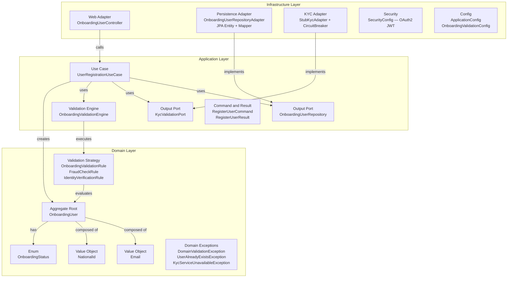

# Onboarding Service

> **Enterprise-grade user onboarding microservice** built on **Java 21** and **Spring Boot 4.1**, implementing Clean Architecture with strict layer isolation, Domain-Driven Design value objects, and production-ready resilience patterns.

[](https://openjdk.org/projects/jdk/21/)
[](https://spring.io/projects/spring-boot)
[](https://www.postgresql.org/)
[](https://flywaydb.org/)
[](https://spring.io/guides/tutorials/spring-security-and-angular-js/)
[](https://resilience4j.readme.io/)

---

## Table of Contents

1. [Project Overview](#project-overview)
2. [Architecture](#architecture)
3. [Key Engineering Decisions](#key-engineering-decisions)
4. [Technology Stack](#technology-stack)
5. [Quickstart](#quickstart)
6. [Configuration](#configuration)
7. [API Documentation](#api-documentation)
8. [Project Structure](#project-structure)
9. [Testing](#testing)

---

## Project Overview

The **Onboarding Service** is a production-ready REST microservice responsible for registering new users and orchestrating their KYC (Know Your Customer) validation workflow. It is designed to serve as a reference implementation of enterprise Java engineering standards, demonstrating how Clean Architecture, Domain-Driven Design, and modern Spring Boot capabilities compose into a maintainable and testable codebase.

**Core responsibilities:**
- Accept user registration requests (e-mail + national ID)
- Enforce domain invariants via self-validating Value Objects
- Orchestrate KYC validation with configurable fault tolerance (Circuit Breaker + graceful fallback to `MANUAL_REVIEW`)
- Persist onboarding state with full audit trail and optimistic concurrency control
- Expose a secured REST API documented with OpenAPI 3

---

## Architecture

The service enforces a **strict unidirectional dependency rule**: outer layers may depend on inner layers, but never the reverse.

```
Infrastructure  →  Application  →  Domain
```



### Layer Responsibilities

| Layer | Responsibility | Framework coupling |
|---|---|---|
| **Domain** | Business rules, value objects, aggregate state transitions, domain exceptions | ❌ None — pure Java |
| **Application** | Use case orchestration, output port interfaces, validation engine | ❌ None — registered via `@Bean` |
| **Infrastructure** | HTTP adapters, JPA persistence, KYC client, security, Spring config | ✅ Spring, JPA, Resilience4j |

---

## Key Engineering Decisions

### 1. Value Objects — Eliminating Primitive Obsession

`Email` and `NationalId` are immutable Java `record` types that self-validate on construction. A `String` can be anything; an `Email` is guaranteed to be a valid email address throughout the entire codebase.

```java
// Before — Primitive Obsession: the compiler cannot help you
public record RegisterUserCommand(String email, String nationalId) {}

// After — Value Objects: invariants are enforced at the boundary
Email email = new Email(command.email().trim());         // throws DomainValidationException if invalid
NationalId nationalId = new NationalId(command.nationalId().trim());
```

Benefits: eliminates duplicated validation guards, makes illegal states unrepresentable, and turns the domain model into self-documenting code.

---

### 2. Strategy Pattern — Pluggable Validation Engine

The `OnboardingValidationEngine` (Application layer) holds a `List<OnboardingValidationRule>` injected by Spring. Each rule is an independent Strategy:

```java
// Domain — the contract
public interface OnboardingValidationRule {
    boolean isValid(OnboardingUser user);
}

// Domain — concrete strategies
class FraudCheckRule           implements OnboardingValidationRule { ... }
class IdentityVerificationRule implements OnboardingValidationRule { ... }
```

Adding a new validation requires only implementing `OnboardingValidationRule` and registering the bean — zero modifications to existing code (Open/Closed Principle).

---

### 3. Transactional Outbox Pattern (Architecture-Ready)

The persistence adapter (`OnboardingUserRepositoryAdapter`) owns the `@Transactional` boundary. The use case itself carries **no** `@Transactional` annotation — it is framework-agnostic. This separation keeps the door open to replace the transaction mechanism (e.g., adopting the full Transactional Outbox pattern with event publishing) without touching business logic.

---

### 4. Optimistic Locking — `@Version`

The JPA entity carries a `@Version Long version` field, providing optimistic concurrency control out of the box:

```java
@Version
@Column(name = "version")
private Long version;
```

Concurrent updates to the same record cause an `OptimisticLockException`, which the `GlobalExceptionHandler` maps to HTTP `409 Conflict` — preventing silent data corruption with zero deadlock risk.

---

### 5. Flyway — Versioned Database Migrations

All schema changes are managed as immutable, versioned SQL scripts under `src/main/resources/db/migration/`. DDL is never auto-generated by Hibernate (`ddl-auto: validate`).

| Version | Description |
|---|---|
| `V1` | Create `onboarding_users` table with unique constraints on `email` and `national_id` |
| `V2` | Add `version` (optimistic lock) and audit timestamp columns |
| `V3` | Rename `last_modified_date` → `updated_at` for naming consistency |

---

### 6. OAuth2 JWT Resource Server

Every protected endpoint requires a valid Bearer JWT. The stateless security filter chain is configured in `SecurityConfig`:

```java
.oauth2ResourceServer(oauth2 -> oauth2.jwt(Customizer.withDefaults()))
```

OpenAPI/Swagger UI routes (`/v3/api-docs/**`, `/swagger-ui/**`) are explicitly **permit-listed** to allow unauthenticated documentation browsing during development.

---

### 7. Resilience4j Circuit Breaker — KYC Fault Tolerance

KYC validation is wrapped with a Resilience4j `@CircuitBreaker`. When the external KYC service is unavailable, the circuit breaker trips and the fallback method re-throws a `KycServiceUnavailableException`. The use case catches this exception and gracefully degrades — registering the user with `MANUAL_REVIEW` status instead of failing the entire request.

```
KYC available    → status: PENDING_VALIDATION
KYC unavailable  → status: MANUAL_REVIEW  (graceful degradation)
```

---

## Technology Stack

| Category | Technology | Version |
|---|---|---|
| Runtime | Java (OpenJDK) | 21 (LTS) |
| Framework | Spring Boot | 4.1.1 |
| Persistence | Spring Data JPA + Hibernate | via Boot BOM |
| Database | PostgreSQL | 15 |
| Migrations | Flyway | via Boot BOM |
| Security | Spring Security OAuth2 Resource Server | via Boot BOM |
| Resilience | Resilience4j | 2.2.0 |
| API Docs | Springdoc OpenAPI (Swagger UI) | 2.8.9 |
| Build | Maven Wrapper | 3.x |
| Utilities | Lombok | via Boot BOM |
| Test DB | H2 (in-memory) | via Boot BOM |

---

## Quickstart

### Prerequisites

- **Docker & Docker Compose** (for the database)
- **Java 21** (`java -version` should report 21+)
- **Maven** (or use the included `./mvnw` wrapper)

### Step 1 — Start the Database

```bash
docker-compose up -d
```

This starts a PostgreSQL 15 container (`postgres-onboarding`) on port `5432`. Flyway will automatically apply all migrations on first application startup.

### Step 2 — Run the Application

```bash
./mvnw spring-boot:run
```

On Windows:

```cmd
mvnw.cmd spring-boot:run
```

The service starts on **http://localhost:8080**.

### Step 3 — Verify

```bash
curl http://localhost:8080/v3/api-docs
```

---

## Configuration

All configuration is managed via `src/main/resources/application.yml`. Key properties can be overridden via environment variables:

| Property | Env Variable | Default | Description |
|---|---|---|---|
| `server.port` | — | `8080` | HTTP port |
| `spring.datasource.url` | `SPRING_DATASOURCE_URL` | `jdbc:postgresql://localhost:5432/onboarding_db` | JDBC URL |
| `spring.datasource.username` | `SPRING_DATASOURCE_USERNAME` | `postgres` | DB username |
| `spring.datasource.password` | `SPRING_DATASOURCE_PASSWORD` | `password` | DB password |
| `spring.security.oauth2.resourceserver.jwt.issuer-uri` | — | `https://dummy-idp.local/` | JWT issuer for token validation |
| `kyc.stub.enabled` | — | `true` | Activates the stub KYC adapter (disable in production) |
| `kyc.stub.failure-rate` | — | `0.0` | Fraction of random KYC failures (for chaos testing) |
| `kyc.stub.simulate-latency` | — | `false` | Adds artificial latency to KYC stub calls |

> **Production note:** Set `kyc.stub.enabled=false` and provide a real `KycValidationPort` implementation annotated with `@Profile("production")` before deploying to live environments.

---

## API Documentation

### Swagger UI

Interactive API documentation is available at:

```
http://localhost:8080/swagger-ui/index.html
```

### OpenAPI JSON Specification

The raw OpenAPI 3 specification (for Postman import or code generation) is served at:

```
http://localhost:8080/v3/api-docs
```

**Importing into Postman:**
1. Open Postman → **Import**
2. Select **Link** and enter `http://localhost:8080/v3/api-docs`
3. Postman will generate a fully configured collection with request bodies and examples

### Endpoints

| Method | Path | Auth | Description |
|---|---|---|---|
| `POST` | `/api/v1/onboarding/users` | 🔒 Bearer JWT | Register a new user for onboarding |
| `GET` | `/swagger-ui/index.html` | 🔓 Public | Interactive Swagger UI |
| `GET` | `/v3/api-docs` | 🔓 Public | OpenAPI JSON spec |

#### Sample Request

```http
POST /api/v1/onboarding/users
Authorization: Bearer <your-jwt-token>
Content-Type: application/json

{
  "email": "jane.doe@example.com",
  "nationalId": "123456789"
}
```

#### Sample Response — `201 Created`

```json
{
  "id": "550e8400-e29b-41d4-a716-446655440000",
  "email": "jane.doe@example.com",
  "nationalId": "123456789",
  "status": "PENDING_VALIDATION",
  "createdAt": "2026-10-02T00:30:00"
}
```

#### Onboarding Status Values

| Status | Description |
|---|---|
| `PENDING_VALIDATION` | User registered, KYC passed — awaiting final approval |
| `MANUAL_REVIEW` | KYC service was unavailable; record queued for manual review |
| `APPROVED` | Onboarding completed successfully |
| `REJECTED` | Onboarding rejected after review |

---

## Project Structure

```
src/main/java/.../onboarding_service/
│
├── domain/                              # Inner-most layer — zero framework dependencies
│   ├── model/
│   │   ├── OnboardingUser.java          # Aggregate root (pure POJO, @Builder)
│   │   ├── Email.java                   # Value Object — self-validating record
│   │   ├── NationalId.java              # Value Object — self-validating record
│   │   └── OnboardingStatus.java        # Enum: PENDING_VALIDATION | MANUAL_REVIEW | APPROVED | REJECTED
│   ├── validation/
│   │   ├── OnboardingValidationRule.java    # Strategy interface
│   │   ├── FraudCheckRule.java              # Concrete strategy
│   │   └── IdentityVerificationRule.java    # Concrete strategy
│   ├── repository/
│   │   └── OnboardingUserRepository.java    # Output port interface (domain-owned)
│   └── exception/
│       ├── DomainValidationException.java
│       ├── UserAlreadyExistsException.java
│       └── KycServiceUnavailableException.java
│
├── application/                         # Orchestration — use cases and ports
│   ├── usecase/
│   │   ├── UserRegistrationUseCase.java     # Core use case (no Spring annotations)
│   │   ├── RegisterUserCommand.java         # Input DTO (record)
│   │   └── RegisterUserResult.java          # Output DTO (record)
│   ├── validation/
│   │   └── OnboardingValidationEngine.java  # Runs all registered OnboardingValidationRule strategies
│   └── port/
│       └── KycValidationPort.java           # Output port for KYC integration
│
└── infrastructure/                      # Outer layer — Spring, JPA, HTTP
    ├── web/
    │   ├── OnboardingUserController.java    # REST adapter (@RestController)
    │   ├── GlobalExceptionHandler.java      # @RestControllerAdvice — maps exceptions to HTTP
    │   └── dto/                             # Request/Response DTOs
    ├── persistence/
    │   ├── OnboardingUserJpaEntity.java     # JPA entity with @Version + audit fields
    │   ├── OnboardingUserMapper.java        # Domain to JPA entity mapping
    │   ├── OnboardingUserRepositoryAdapter.java  # Implements domain repository port (@Transactional)
    │   └── SpringDataOnboardingUserRepository.java # Spring Data JPA interface
    ├── kyc/
    │   └── StubKycAdapter.java             # @ConditionalOnProperty KYC stub with CircuitBreaker
    ├── security/
    │   └── SecurityConfig.java             # OAuth2 JWT stateless filter chain
    └── config/
        ├── ApplicationConfig.java           # Wires use cases as @Bean (no @Service)
        └── OnboardingValidationConfig.java  # Collects and orders validation rule beans
```

---

## Testing

Run the full test suite:

```bash
./mvnw test
```

Tests use **H2 in-memory database** with Flyway migrations applied automatically — no Docker required for unit or integration tests.

```bash
# Run with verbose output
./mvnw test -Dsurefire.useFile=false
```
